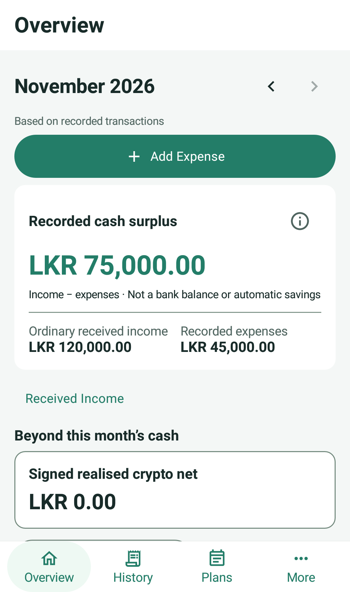
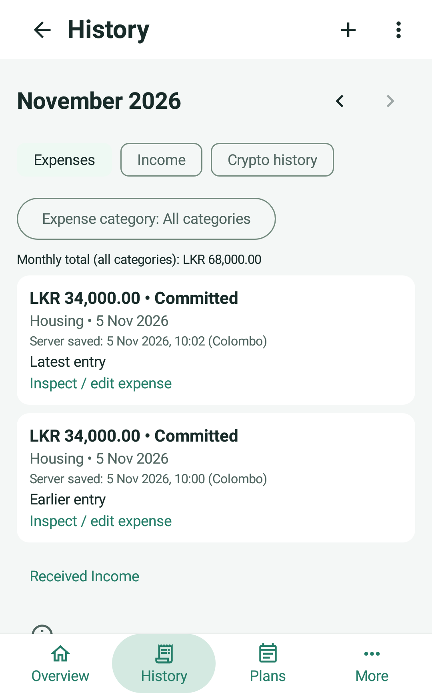

# Clarity Finance

Clarity Finance is a manual personal-finance Android app for recording what was received, spent and explicitly set aside. It combines everyday expense capture with monthly reporting, pending freelance agreements, realised crypto results, one savings goal and reviewed recurring expenses.

## Download and install

[Download Clarity 1.0 APK](https://github.com/it23585294/clarity-finance/releases/download/v1.0-submission-20261105/Clarity-Finance-1.0-debug.apk) | [GitHub Release](https://github.com/it23585294/clarity-finance/releases/tag/v1.0-submission-20261105) | [SHA-256 checksum](https://github.com/it23585294/clarity-finance/releases/download/v1.0-submission-20261105/Clarity-Finance-1.0-debug.apk.sha256)

**Android 8.0/API26 or newer. Version 1.0, versionCode 1.** This is the existing **debug-signed, debuggable application APK**, not the test APK or a Play Store publication. The assignment permits a debug APK. Normal app-icon launch opens the production Firebase sign-in flow; opt-in debug test helpers are not the launcher.

This repository and its releases are **private**. Downloaders need authorized GitHub access and a signed-in browser/session; a direct link does not grant access. Repository visibility and assessor access are not changed by publishing this release.

1. On Android, open the download link in an authorized GitHub session and download `Clarity-Finance-1.0-debug.apk`. Alternatively, open the Release page and choose that APK under Assets.
2. Open the downloaded APK. If prompted, allow installation from the browser or file manager you are using, then return to the installer.
3. Choose Install (or the in-place update offered for a compatible existing installation), then open **Clarity** from the app icon.
4. Existing users: an update must use the matching signing certificate. If Android reports a signing/package conflict, stop and obtain a matching-signed build. **Do not uninstall or clear app data to bypass it**: unsynchronised proposals may be lost. The separate-device check used `install -r` with a matching certificate and preserved storage.

APK SHA-256:

```text
61512e5e8884077dcef4dde8c94075f54fff18f1c7e572938dc49bed5c453752
```

Application build source: [`4b7a468928a231a371e793a72e1e37c9f7755c59`](https://github.com/it23585294/clarity-finance/commit/4b7a468928a231a371e793a72e1e37c9f7755c59). The release tag also contains documentation-only publication instructions; application/build/security inputs remain identical to the verified APK. See [APK build/install verification](docs/APK_SUBMISSION.md).

## First use

1. Connect to the internet. Use **Create an account** to register with your own email/password, or **Sign In** with an existing account. Authentication requires connectivity; no credentials are supplied in this repository.
2. **Overview** shows the selected month's recorded income, expenses and cash surplus. Use its Received Income link for actual receipts; crypto, current pending and savings remain separate.
3. Choose **Add Expense**, enter a positive LKR amount, review category/channel/spending type and actual date, optionally add a note, then Save.
4. **History** lets you change month, switch Expenses/Income, filter categories and inspect records. Use existing edit/backdate/delete actions; linked receipts retain agreement protections.
5. **Plans** opens Pending Payments, Savings Goal and Recurring Expenses. **More** opens Crypto Results, Categories & Sources, scoped Saved Changes and Sign Out.
6. Offline proposals can be saved locally, but **pending is not confirmed**. Confirmed totals retain their previous contributions while changes await acknowledgement. Reconnect with the app open to reconcile; if it was stopped, reopen it. Synchronization is not guaranteed while force-stopped. Do not clear storage or repeatedly create replacement records for an uncertain outcome.

## Final interface

<p>
  
  
</p>

These are selected recorded production-screen captures with fictional isolated data, not live accounts. Their fixtures are independent. Source/provenance is in [report assets](docs/report/ASSETS.md).

## Features and financial meaning

- Email/password registration, sign-in/out and UID-scoped records/recovery.
- Received-income capture, inspection, editing, deletion and backdating. LKR/USD receipts retain original values and a fixed conversion basis/rate or actual credited LKR.
- Pending standalone/project agreements, milestones, direct/partial receipts, edits and cancellation. Linked income routes to the agreement and cannot be independently detached from payment accounting.
- Amount-first expenses with category, channel, committed/discretionary type, actual date and optional note; editing/deletion retain confirmation safeguards.
- Overview, monthly History/category drill-down and spending insights. Cash surplus is **ordinary received income minus recorded expenses**, not a bank balance, safe-to-spend amount or automatic saving.
- Signed realised crypto/month/YTD results, separate from ordinary income and expenses.
- One explicit savings goal with opening allocation, contributions/withdrawals, corrections, history and anchored monthly schedule. The app records allocations; it does not transfer or verify funds.
- Monthly recurring templates with due/overdue review and user-confirmed actual expenses. Unconfirmed suggestions do not count as spending; consumed history prevents reconfirmation after actual deletion.
- Custom category/source add, rename and archive. Stable IDs preserve history and permitted inherited references.

Navigation is **Overview / History / Plans / More**, with Add Expense prominent and focused forms outside the shell. One shared teal/mint light/dark theme follows the system setting. Pending, cached, rejected and uncertain states remain explicit; unknown data is not fabricated as zero. Current collectible pending is grouped by original currency, excludes cancelled parents and counts the parent once rather than adding milestones again.

## Technology and architecture

Kotlin application source, Jetpack Compose Material3, Navigation Compose, ViewModels, read-only StateFlow, coroutines, **Koin 4.1.1**, Firebase Authentication/Cloud Firestore and DataStore. There are no Java application files or XML layouts; standard JVM/Android/Firebase APIs are used. Room is not a project dependency.

Current build declarations: AGP 9.3.3, Kotlin 2.2.10, Gradle 9.5.0, Compose BOM 2026.02.01, Firebase BOM 34.2.0, minSdk 26, targetSdk 36 and compileSdk 37 minor 1. The [version catalog](gradle/libs.versions.toml), [app build](app/build.gradle.kts) and [wrapper](gradle/wrapper/gradle-wrapper.properties) are authoritative; do not upgrade to prepare a demonstration.

```text
Compose / Navigation
  -> owning ViewModel (read-only StateFlow, UI actions)
  -> repository + exact domain calculations
  -> Firebase remote adapters / one DataStore recovery store

Application -> one UID/session synchronization coordinator -> repository workers
```

The [Koin modules](app/src/main/java/com/clarity/finance/di/AppModules.kt) provide process-singleton clients, stores and repositories retaining in-flight Tasks. Android's owning ViewModelStore controls ViewModel reuse/clearing; Koin creation extras preserve SavedStateHandle where applicable. Screens do not instantiate manual ViewModels or call Firebase directly. Business money uses checked Long minor units and BigDecimal, not Double totals.

## Prerequisites and authorized configuration

1. Obtain access to this existing private repository and use its Gradle wrapper.
2. Install Android Studio/SDK components matching the project, including compile SDK37 minor 1 and platform/build tools. [Daemon criteria](gradle/gradle-daemon-jvm.properties) select Java 21; configure a compatible Gradle JDK. App Java 11 source compatibility is not the build-daemon JDK.
3. Obtain authorized Firebase Android configuration for package `com.clarity.finance` and the existing approved Firebase project. Place `google-services.json` in `app/`; keep it ignored. Enable/configure email/password Auth through the project's authorized process. Never add service-account credentials, signing passwords or tokens to source.
4. Set the local Android SDK path through Android Studio/local.properties. These machine-specific files are not committed.
5. Review [complete Firestore rules](firestore.rules), [indexes](firestore.indexes.json) and [Firebase tooling](firebase.json). The recurring-history composite index is COLLECTION `recurringOccurrences`: `templateId ASC`, `month ASC`. Preserve unrelated deployed indexes. **Publication is a separate authorized action**, not part of build/run instructions.

The production app uses the existing live Firebase target. Local `demo-*` projects are for isolated tests; do not silently redirect production. The submitted APK must connect to live Firebase under the assignment brief.

## Build and run

From the repository root on Windows:

```powershell
.\gradlew.bat :app:assembleDebug
```

Application APK: `app/build/outputs/apk/debug/app-debug.apk`. The Android test APK is a different artifact. A debug or release-signed app APK is permitted by the specification; record its version/hash/source for submission. For normal operation launch MainActivity through the app icon, not the fictional acceptance host.

**Inspect the intended test device's saved auth/recovery before installing-and-running or launching instrumentation. Application starts app-wide sync before a test body.** Do not use Pixel_6a or an unreviewed live session. Do not clear app/emulator storage, uninstall, retry unrelated proposals or change the DNS workaround. Installation/launch is deliberately not scripted here for an arbitrary connected device.

## Tests and safe execution

Unit/build/lint checks use the existing project:

```powershell
.\gradlew.bat :app:testDebugUnitTest :app:assembleDebugAndroidTest :app:lintDebug
```

Rules tests use the checked-in Node package/lock in `firestore-tests/`, existing compatible Firebase CLI/Java/Node and a local demo emulator:

```powershell
npm --prefix firestore-tests ci
firebase.cmd emulators:exec --only firestore --project demo-clarity-protocol-review "npm --prefix firestore-tests test"
```

These commands do not authorize a rules deployment or live financial writes. Never use a real project ID as a substitute for the demo-test context. Do not expose private emulator snapshots or credentials in logs/source.

Android tests use isolated fake-repository graphs and production screens. **Do not run connected instrumentation blindly against every device.** Inspect saved default auth/recovery first, select an approved separate device explicitly and use the intended isolated graph. Existing opt-in live audit tests are read-only/skipped by default; do not enable them without separate authorization.

The retained [guarded human-review launcher](tools/acceptance/isolated_review.py) is standard-library-only and whitelists the previously inspected `Clarity_UI_Pilot_API26` / `emulator-5564`:

```powershell
python -B tools/acceptance/isolated_review.py --serial emulator-5564
```

It verifies AVD identity and saved auth/recovery **before** launch and stops on unexpected data. It does not install, sign in, clear storage or change settings. Do not replace its serial/guard to bypass a stop. Require the **ISOLATED ACCEPTANCE** banner; the fixture is process-memory-only. Its simulated acknowledgement proves no Firebase persistence, offline durability or production authentication. No additional timed human run is requested.

## Offline behaviour and history

Financial proposals are durably persisted before submission with UID/type/record scope, stable IDs and immutable payloads. Matching server proofs reconcile before another mutation. Expected versions expose conflicts; fences prevent an uncertain operation from later committing before safe replacement. Timeout, cancelled await or later access error does not prove a prior write failed. Local cleanup failure cannot authorize another financial mutation. Confirmed contributions remain during pending/rejected edits/deletions.

One application-owned session coordinator resumes eligible feature workers without reopening their screens. It retries while the process/session is alive and resumes saved work after a later eligible restart. **No guaranteed immediate background execution while stopped or force-stopped is claimed.** Authentication remains online; previously cached records can be shown with truthful labels, while uncached offline data is unavailable rather than confirmed zero. Account switches clear old screen/feedback state and keep proposals with their originating UID.

History order is actual transaction/expense/result date descending, then immutable server `createdAt` descending, then ID ascending for equal/missing times. Known times precede unknown ones within a date. Filters preserve relative order. Changing amount/note/category does not reorder by `updatedAt`; backdating moves the group/month. Server-saved time can be later than original offline entry and is labelled accordingly. Missing legacy times are never invented.

## Report and verified evidence

- [Canonical 17-page report PDF](docs/report/Clarity_Finance_Report.pdf), [editable DOCX](docs/report/Clarity_Finance_Report.docx) and [Markdown source](docs/report/Clarity_Finance_Report.md).
- [Requirements/rubric coverage and submission handoff](docs/report/REQUIREMENTS_MAP.md), [original specification](docs/requirements/assignment-specification.pdf) and [original derived requirements](docs/requirements/analysis-and-requirements.pdf).
- [Consolidated verification and offline-action matrix](docs/VERIFICATION.md), [figure sources/provenance](docs/report/ASSETS.md) and [cleanup/preservation record](docs/REPOSITORY_CLEANUP.md).

Latest recorded application evidence: **292 unit tests**, final **8 isolated API26 Android cases**, successful app/test builds and lint **0 errors/16 warnings**. **147 rules tests** are reused unchanged evidence. Focused/earlier counts overlap and must not be added. These are recorded application checks, not reruns performed for documentation cleanup.

Five human captures were correct with approximate clock-based feedback, not exact stopwatch measurements. Actual TalkBack remains unexecuted. Historical API35 native/system instability is unresolved; a later boot was disk-blocked, so there is no clean final full-suite API35 claim. Final-render performance, deployed-source byte equality and broader live migration/in-flight races have explicit limits in the verification record. No blanket crash-free, security or release-certification claim is made.
