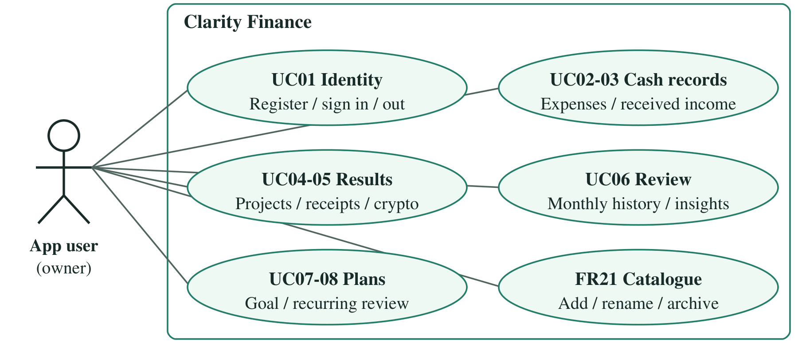
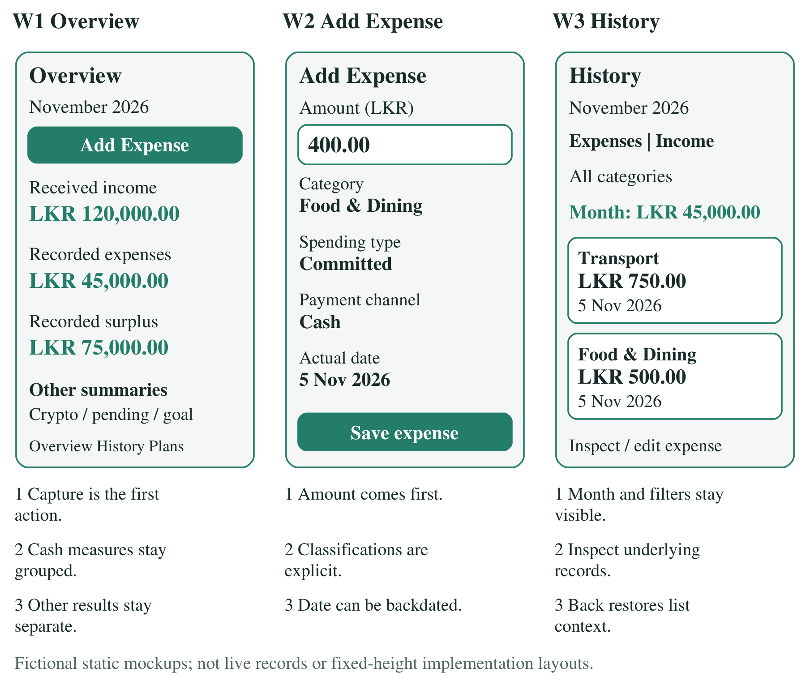
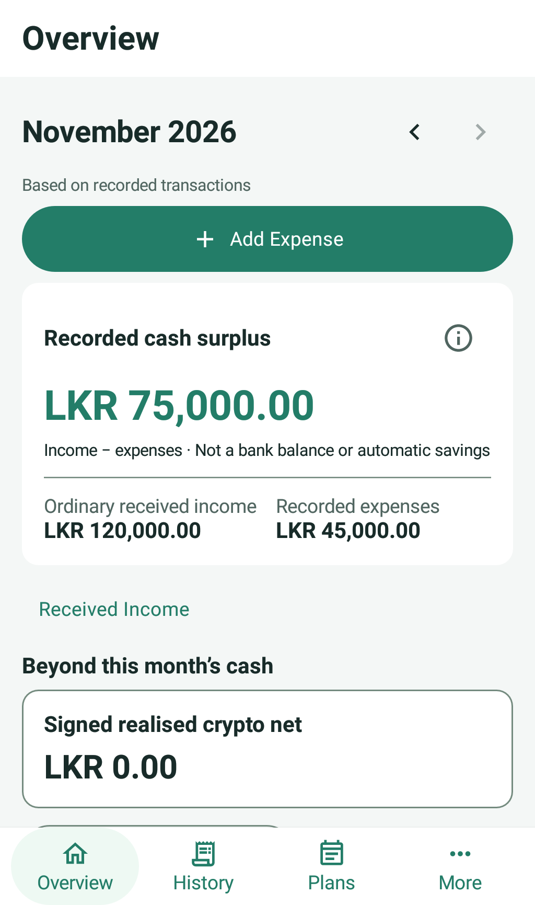
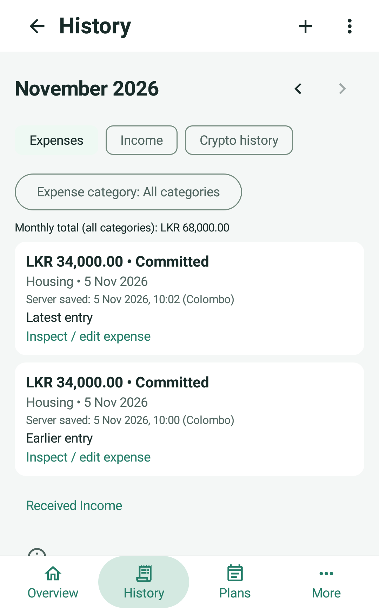
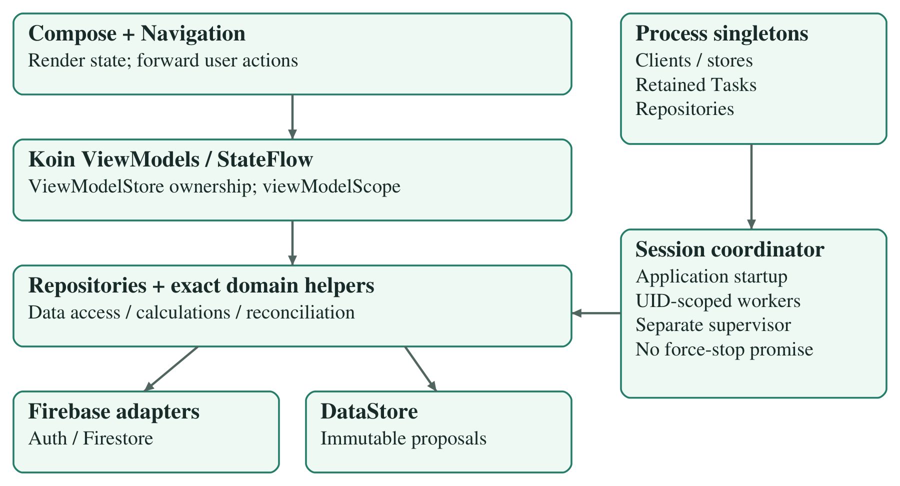
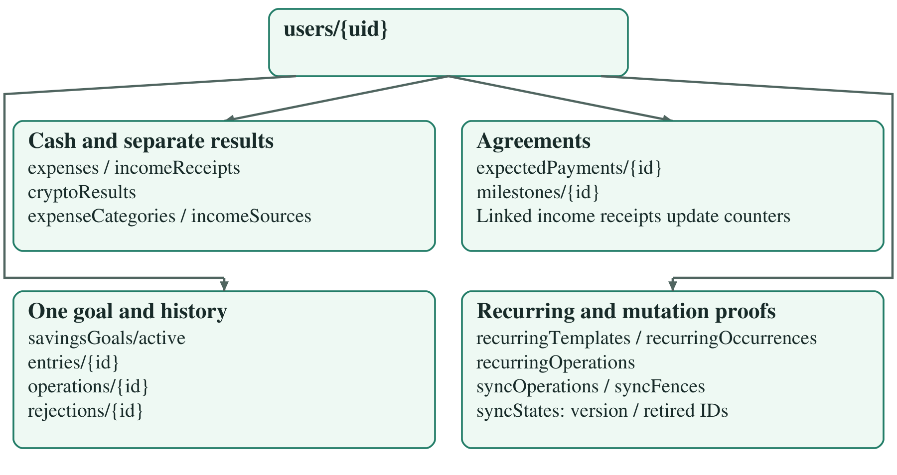
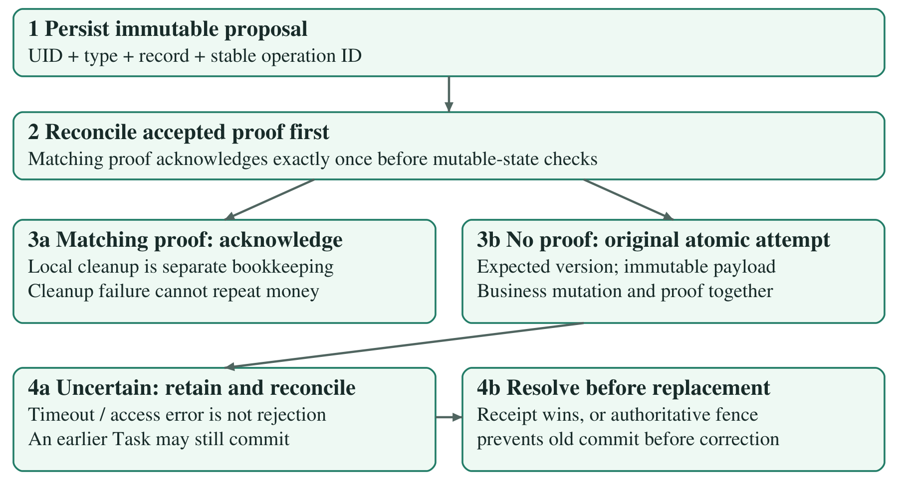

<!-- page: Cover -->
# Clarity Finance

## Personal finance management for Android

**SE3092 - Platform Based Development, Assignment 01** 
BSc (Hons) in Computer Science, Year 3, Semester 2, 2026 
**5 November 2026**

### Confirmed team

| Student ID | Name |
|---|---|
| IT23585294 | P.S.D. Hewage |
| IT23619012 | Oshan Amarasinghe |
| IT23680470 | G.D.C. Dabarera |

### Abstract

Clarity Finance supports manual recording of received income, expenses, pending freelance payments, realised crypto results, savings allocations and recurring obligations. It addresses the supplied case of Kavindu Silva, whose varied income and fragmented spending are difficult to understand across separate tools. The application combines a low-effort capture flow with monthly analysis, while keeping promised money, investment results and recorded savings distinct from ordinary cash transactions.

Kotlin, Jetpack Compose, Koin and Firebase support a layered implementation. Exact monetary arithmetic, owner-scoped security and durable immutable proposals protect financial meaning during interruption and reconnection. Evaluation combines unit assertions, isolated Android checks, local Firebase tests, bounded live acceptance and human feedback. Evidence limitations remain explicit.

### Assistance disclosure

OpenAI Codex assisted implementation, UI design, debugging, tests, diagrams and documentation under the user's direction. The user reviewed outcomes and performed human captures. The team must review, understand and take responsibility for the submitted work; this report does not claim unaided authorship or invent individual contributions.

### Administrative details still to confirm

**[Group identifier, if required; each member's actual contribution; current LMS deadline or approved extension and demonstration slot; any separate formatting/citation instructions.]** The original brief prints 30 October 2026. This report is not backdated. The user confirmed the roster above; no contribution percentages are assumed.

<!-- page: Summary and contents -->
# Summary and contents

### System overview

The application answers three everyday questions: what money was actually received, what was recorded as spent, and what those records reveal about the selected month. Overview prioritises Add Expense. History exposes the transactions behind totals. Plans groups agreements, a savings goal and recurring obligations; More provides other records, catalogues, saved-change review and account access.

The main design decision is to preserve financial distinctions. A promised project payment is not received income. A realised crypto gain is not ordinary cash income. Recorded surplus is not a bank balance or automatically saved money. A goal allocation records the user's intention, not a bank transfer. A recurring template is a suggestion until a payment is confirmed.

The report explains the final system, its scenario-based rationale and the limits of available evidence. Original requirements/specification PDFs, source-level traceability, setup instructions and consolidated verification are supplied with the project. Fictional screenshots and design mockups are labelled; they do not represent personal finances or prove cloud persistence.

### Contents

1. Problem, objectives and functional scope
2. Quality requirements and use cases
3. Interaction design and annotated mockups
4. Selected final interface
5. Architecture and dependency ownership
6. Firestore data model and queries
7. Exact calculations and financial separation
8. Agreements, receipts and catalogues
9. Savings goals and recurring expenses
10. Authentication and server integrity
11. Offline persistence and recovery
12. Lifecycle and truthful feedback
13. Testing strategy and results
14. Acceptance and user evaluation
15. Limitations and conclusion

<!-- page: Requirements -->
## 1. Problem, objectives and functional scope

Kavindu is the assignment's supplied persona: a 25-year-old junior engineer in Colombo with variable salary, freelance receipts, USD AdSense income and realised crypto gains or losses. Cash and secondary-card spending are easy to miss. He wants a laptop costing approximately LKR 490,000, with LKR 11,200 recorded starting savings. These are scenario facts, not interview findings.

Spreadsheets demanded maintenance; rigid applications did not fit his income; notes lacked analysis; bank views covered only part of his activity. The objective is therefore understandable financial visibility with low-effort capture and honest correction after gaps. The scope follows the supplied Analysis and Requirements document, sections 4-6.

| Requirement | Final implementation |
|---|---|
| FR01-02: identity and ownership | Email/password registration, sign-in/out, owner-scoped records and recovery; old-user state clears on account change. |
| FR03-04: received income and conversion | Inspect/create/edit/delete/backdate receipts; retain original currency, fixed conversion basis/rate or actual LKR credit. |
| FR05-06: pending agreements | Standalone/project agreements, milestones, partial/direct receipts, edits and cancellation; received and outstanding remain separate. |
| FR07: realised crypto | Positive gain/loss input, signed monthly/YTD results, inspection and correction/deletion. |
| FR08-10: expense capture | Amount-first entry, category/channel/type/date/note, inspection, edit/delete and backdating. |
| FR11-13: monthly reporting | Ordinary history/category drill-down, cash surplus, category bars and committed/discretionary split. |
| FR14-16: savings | One active goal, explicit allocation ledger, anchored schedule, required contribution and reached/overdue states. |
| FR17: recurring expenses | Monthly templates, due/overdue review, changed actual amount/date and exactly-once confirmation. |
| FR18-20: persistence and feedback | Realtime records, cached views, durable proposals, reconciliation, validation and recoverable errors. |
| FR21: personal catalogues | Add, rename and archive categories/sources with stable historical references. |

FR21 is a Should in the analysis document and is included in the delivered scope. Optional FR22-25 are deferred. There is no bank import/linking, trading, tax calculation, automatic payment/transfer, forecasting or multiple-goal feature.

Acceptance examples provide concrete checks rather than feature-count targets. They include fixed USD conversion, partial freelance receipts, crypto net, category correction, spending percentages, explicit goal allocations and recurring uniqueness. Capturing after missed days remains legitimate: backdating changes the reporting period without penalties or invented records.

<!-- page: Quality and use cases -->
## 2. Quality requirements and use cases

The original brief requires Kotlin, Compose Material3, Navigation Compose, MVVM, observable state, coroutines, Firebase Authentication/Firestore and Hilt or Koin. The app uses Koin. Minimum SDK is 26 and target SDK is 36. There are no Java application files or XML layouts; Kotlin uses standard JVM/Android/Firebase APIs. Room is recommended, not mandatory: Firestore cache plus DataStore is the selected persistence approach.

| Quality requirement | Design response and evaluation boundary |
|---|---|
| NFR01: low effort | Target: at least 4/5 familiarised captures within 10 seconds. Five were correct; timing was approximate, not stopwatch-measured. |
| NFR02: feedback speed | Target: cached dashboard <=2s and local feedback <=1s in >=9/10 trials with 1,000 records. Historical SDK evidence is separate from final rendering. |
| NFR03-04: reliability/exactness | Durable identities, reconciliation, checked integer minor units and BigDecimal; no floating-point money totals. |
| NFR05: security | Owner-only rules, UID-scoped recovery and no saved passwords. |
| NFR06: accessibility | 48dp targets, descriptions, readable enlarged layouts and non-colour cues; actual TalkBack remains unexecuted. |
| NFR07-08: honesty/structure | Backdating and labelled recorded data; read-only ViewModel state with repository-owned data access. |
| NFR09-10: access/errors | Date bounds/indexes, listener cleanup and usable empty, denied, uncertain, conflict and overdue states. |

The primary actor is the individual user. Employers, banks and exchanges are real-world context, not integrated actors. The team and assessors need explainable requirements, reproducible setup and verifiable implementation. No administrator or shared-household role is invented. The use cases connect daily recording to review and longer-term plans without requiring every feature during expense capture.

<!-- page: Annotated wireframes -->
## 3. Interaction design and annotated mockups

The final shell is Overview / History / Plans / More. Focused forms hide top-level navigation, leaving room for input and keyboard actions. Back restores the owning context. Labels describe actions rather than implementation details; linked receipts retain protected agreement routing.

The shared light palette uses primary teal #237D68, pale mint #EEF9F3 and dark readable body text. The reviewed dark palette follows the system setting. Typography, spacing, fields and dialogs are shared across authentication and financial screens. Grouped amounts and readable dates improve scanning without changing stored values. Longer explanations use labelled information actions; essential financial meanings remain visible. At enlarged text, controls reflow and content scrolls instead of shrinking important amounts.

<!-- page: Final UI -->
## 4. Selected final interface

These existing recorded captures use production screens with fictional isolated repositories. They show the approved palette and History behaviour, not live accounts or new cloud tests. Each is an independent fixture; their totals must not be combined.

Overview keeps daily capture one action away. History makes underlying records primary, with compact month/mode/category selection. Inspection retains month, filter and scroll context; All recorded expenses remains reachable. Editing or backdating reuses existing forms, and deletion retains confirmation safeguards. Colour is not the only signal: labels, signs, amounts and explicit status text remain visible. The interface calls the monthly difference recorded cash surplus, never a bank balance or automatic saving.

<!-- page: Architecture -->
## 5. Architecture and dependency ownership

One production Activity hosts Navigation Compose. Screens render state and forward events; ViewModels coordinate state and validation; repositories isolate Firebase/local access. Shared model helpers own calculations and schedules. Composables do not calculate authoritative balances or call data sources.

Koin 4.1.1 supplies FirebaseAuth, FirebaseFirestore and the existing DataStore delegate as singletons. Repositories/remotes also retain process lifetimes, particularly where an outstanding Firebase Task must remain known after a screen closes. There is no duplicate DataStore or competing manual container.

Koin-created ViewModels are reused and cleared by Android's owning ViewModelStore; creation extras preserve SavedStateHandle behaviour where applicable. Read-only StateFlow exposes UI state. UI jobs use viewModelScope, while the app-wide coordinator has a process-owned SupervisorJob scope. This deliberate lifetime distinction supports screen-independent recovery rather than tying synchronization to a form.

Tests inject isolated repository graphs into the same production screens. The debug-only human-review host is explicitly fictional and cannot prove Firebase acknowledgement. Production initialization starts synchronization before an instrumentation body, so saved auth/recovery must be inspected before launching tests on any used device. Testing isolation is not a substitute production identity or backend.

<!-- page: Data model -->
## 6. Firestore data model and queries

Firestore is primary persistence. All records are below `users/{uid}` and have strict owner/schema rules. Separate collections preserve financial meanings and mutation protections rather than placing an unbounded ledger array in one user document.

| Record family | Authoritative representation |
|---|---|
| Expense | Positive LKR minor units; category, channel, spending type, actual date, optional note. |
| Income receipt | Original amount/currency, fixed LKR amount and conversion basis/rate; protected links where applicable. |
| Agreement/milestone | Original-currency agreement and received/allocation counters; retained cancellation history. |
| Crypto / savings | Gain/loss plus positive amount; separate goal target/opening and allocation entries. |
| Recurring / catalogue | Template schedule and consumed occurrences; stable category/source IDs, labels and archive state. |

Monthly queries use actual expense/receipt/result dates from month start inclusive to next month start exclusive. They do not group by upload time or hide results behind an undisclosed limit. Required recurring history index: collection-scope `recurringOccurrences`, `templateId ASC`, `month ASC`. Existing unrelated indexes must remain intact. Realtime listeners are removed on cancellation; missing and malformed data stays unavailable rather than becoming a confirmed zero.

<!-- page: Calculations -->
## 7. Exact calculations and financial separation

Money uses Long integer minor units and BigDecimal parsing, conversion and display. LKR 10.00 is 1,000 minor units. Checked arithmetic rejects overflow rather than wrapping into a plausible total. Ordinary amounts must be positive; scientific notation, excess decimal places and invalid/overflow values reject. Float values describe visual progress only.

The reporting timezone is Asia/Colombo. Actual dates are real calendar dates, with nonfuture validation where required; planned deadlines have different semantics. Fixed conversion preserves the original amount and confirmed rate or actual bank credit. A later exchange rate does not rewrite historical receipts.

| Measure / example | Meaning and result |
|---|---|
| Ordinary income | Salary 128,000 plus USD 41 at 300 gives LKR 140,300; original USD and conversion basis remain stored. |
| Recorded cash surplus | Ordinary received income minus expenses: 1,000 - 1,500 = -500. Not a bank balance, safe-to-spend figure or verified saving. |
| Realised crypto | Gain 60,000 - loss 25,000 = +35,000, separate from cash income/expenses. No gross proceeds, capital deposits or unrealised gains. |
| Spending split | Committed 40,000 plus discretionary 10,000 = 50,000; shares 80% / 20%. Category sums equal total expenses. |
| Current pending | Parent outstanding counted once, cancelled parents excluded, LKR and USD grouped separately. Not a historical month-end balance. |
| Recorded savings | Opening + contributions - withdrawals; no automatic transfer from monthly surplus. |

Percentages use consistent complementary rounding; zero spending has no invalid division. If income or expenses are unavailable, surplus is unavailable too, while independent sections remain useful. Crypto aggregate overflow leaves the total unavailable but valid individual records inspectable; malformed-record errors remain explicit.

Crypto YTD means the current year through today in Colombo, or a selected past year through 31 December. Future reporting years are not offered. These boundaries and the ordinary reporting month use transaction dates, not creation timestamps.

History sorts actual date descending, then immutable server creation time descending, then ID ascending for equal or missing times. Known times precede unknown ones within a date. Category filtering preserves relative order. Editing an amount, note or category does not reorder by updatedAt; backdating moves the date group/period. Server-save order can differ from original offline-entry order, and legacy times are never invented.

<!-- page: Payments and catalogues -->
## 8. Agreements, receipts and catalogues

Freelance agreements model expected money independently from receipts. A parent defines the original amount/currency and collectible outstanding. Milestones allocate that agreement rather than adding a second pending total. Receipt confirmation creates one linked income record and adjusts the corresponding counters atomically.

Direct payments have a genuinely optional milestone ID; navigation does not encode a literal null path segment. Milestone receipts validate both parent and milestone capacity. Matching existing confirmations reconcile before mutable records are examined, so retries cannot reset counters or count income twice.

| Action | Preserved accounting behaviour |
|---|---|
| Partial receipt | Agreed 80,000, two receipts of 20,000: received 40,000 and outstanding 40,000, not additional pending income. |
| Milestone cancellation | Keep agreed and received amounts; release only unpaid allocation. Partially paid history remains inspectable. |
| Parent cancellation | Stop new milestones, allocations and receipts; exclude remaining outstanding from collectible totals, retain existing receipt income/history. |
| Linked income inspection | Route to its agreement; independent ordinary editing/deletion cannot detach protected payment accounting. |

Foreign receipts preserve their actual receipt date, original amount and fixed LKR conversion explanation. Pending original currencies are not directly added. Agreement edits use expected versions, and unavailable confirmation metadata explains disabled actions rather than inventing eligibility.

Categories and sources use stable IDs. Rename changes the label, not every historical record. Archive prevents a genuinely new selection but preserves references and totals. Existing corrections may retain an archived reference, and an existing agreement can receive under its inherited archived source. This exception is deliberate; a new agreement cannot adopt an archived choice merely because another agreement used it.

Missing or stale catalogue information remains unknown/unavailable rather than fabricating an active default. The same policy applies across ordinary forms, recurring actuals, receipts and reporting. Catalogue management is visually separate from the scoped Saved Changes panel, which does not claim to display every dedicated feature queue.

These decisions address irregular income without overstating certainty. They also avoid rewriting confirmed history just because a user changes terminology, closes a project or corrects an expense category.

<!-- page: Goals and recurring -->
## 9. Savings goals and recurring expenses

### Explicit savings and schedule

One fixed active goal is enforced beyond UI checks. The user confirms its name, positive target, nonnegative opening allocation and future deadline. Editing metadata does not reset the original start or allocation history. Contributions and withdrawals record money the user says they set aside; the app neither moves nor verifies funds.

`saved = opening + confirmed contributions - confirmed withdrawals`

`remaining = max(target - saved, 0)`

Target 490,000, opening 11,200 and 12 future opportunities give remaining 478,800 and required contribution 39,900, with approximately 2.29% progress. Adding 10,000 produces saved 21,200; withdrawing 1,200 produces 20,000. A simultaneous ordinary surplus of 10,000 does not add another allocation. Overfunding remains visible; only the visual progress bar caps at 100%.

Monthly dates start one month after the original start, use its original day anchor and clamp to month end without cumulative February drift. The deadline adds a final opportunity if needed, with no duplicates or later dates. N counts dates on or after Colombo today. Required amount is remaining/N, rounded upward to the nearest cent. Reached goals show zero; N=0 with remaining positive shows overdue and invites deadline revision.

Ledger corrections/deletions and opening changes cannot produce negative confirmed savings. Concurrent operations must preserve the same constraint. An expired offline deadline proposal can be replaced only after matching receipt reconciliation or authoritative rejection/fencing prevents the old proposal from committing.

### Recurring suggestions become actual expenses only by confirmation

Monthly templates capture a suggested amount, classifications, channel and first due date. Due/overdue occurrences prompt review: the user can change actual amount, date, category, spending type, channel and note. Ignoring an occurrence creates no expense. Monthly dates use the original anchor and stable occurrence identities; template edits do not regenerate confirmed history.

AT09 confirms rent 34,000 exactly once; retry/reopen/another client cannot duplicate it. Unconfirmed utilities add zero; confirmation uses the reviewed actual amount. A conflicting second payload shows the existing result/conflict instead of silently overwriting it.

Actual expenses remain correctable, backdatable and deletable through ordinary flows. Immutable consumed history survives deletion, so retry cannot recreate the expense. Cancelling a template stops all unconfirmed occurrences, including already-due ones, while preserving actual expenses and confirmations. Templates, goal allocations and crypto never silently enter ordinary cash totals.

<!-- page: Security -->
## 10. Authentication and server integrity

Production identity uses Firebase email/password authentication. The UID scopes both remote records and durable local work. Rules require an authenticated matching owner; a signed-in client cannot read/write another user's path. Passwords are not persisted in drafts or logs.

Client validation gives quick feedback; strict rules independently validate allowed/required fields, types, amounts, notes, real-date helpers and timestamp relationships. Regex alone is not treated as real calendar validation. Immutable createdAt is protected, while expected versions detect stale edits.

`syncOperations` stores immutable accepted proofs. `syncFences` prevents a withdrawn proposal from later committing. `syncStates` tracks versions and retired identities so update/delete/recreate cannot bypass replay protection. Business mutations and their matching proofs must occur atomically; proof-only success and counter-only changes reject.

Savings rules couple ledger deltas and parent counters in both directions. Recurring rules couple one occurrence to one actual expense. Payment rules couple receipts to parent/milestone counters. Concurrent mutation and fencing cannot both establish success for one logical operation. Owner checks, raw immutable legacy identities and receipt-first reconciliation protect the same invariants during recovery.

Local rule tests verify allowed counterpart operations as well as bypass denials. Historical live checks establish bounded behaviour under the published environment, not an independently authenticated byte comparison of deployed rules. The submitted complete rules and index definitions remain the source for review.

<!-- page: Offline -->
## 11. Offline persistence and recovery

Firestore cache supplies known records, but transactions are not an offline queue. Before submission, the app durably saves an immutable proposal in DataStore with originating UID, operation type, record identity and stable operation ID. Restart/retry preserves this payload. Local acceptance is not server confirmation.

| Supported action family | Recovery behaviour |
|---|---|
| Expense/income create | Persist once before submission; no confirmed contribution until acknowledgement. |
| Ordinary edit/delete | Keep the old confirmed value while the proposal is pending/rejected; expected version detects conflict. |
| Project/milestone create/edit/cancel | Ordered parent/child proposals and atomic counters; no retry reset or duplicate allocation. |
| Direct/milestone receipt | Stable linked identity; reconcile proof before capacity/mutable-state checks. |
| Crypto create/edit/delete | Dedicated recovery, retained confirmed signed contribution and app/session worker. |
| Goal/ledger create/change/correct/delete | Stable operation and entry IDs, nonnegative atomic balance; safe deadline replacement. |
| Recurring create/edit/cancel/confirm | Saved immutable proposal and consumed occurrence history; never automatic spending. |
| Catalogue add/rename/archive | Owner-scoped stable reference and explicit catalogue completeness/unknown state. |

A matching receipt is checked before issuing another mutation. If accepted, local cleanup may be retried without repeating the financial write. If another payload/version is established, conflict is explicit. Related operations preserve dependencies rather than racing child writes against an unconfirmed parent.

A timeout or cancelled await does not cancel or disprove an earlier Firebase Task. A later authentication/permission error cannot establish that an earlier attempt never committed. The proposal therefore remains uncertain until receipt reconciliation or authoritative rejection/fencing resolves it. Only then may correction/dismissal be offered safely.

Legacy migration retains original operation identity and raw payload, avoiding new IDs for possibly accepted work. Corrupt recovery is surfaced and preserved rather than erased. Remote success and local storage/bookkeeping failures are different outcomes. These policies protect money even when the most honest user message is that the result is still unknown.

The table describes implemented mechanisms, not a claim that every action combination received device/live testing. The consolidated verification record distinguishes suspending fakes, real SDK/emulator runs and bounded live acceptance.

<!-- page: Lifecycle -->
## 12. Lifecycle and truthful feedback

SessionSyncCoordinator starts once from Application, observes the authenticated UID and supervises feature workers. It does not require reopening a particular financial screen. Independent worker errors do not suppress otherwise available reporting sections.

While the process/session is eligible and connectivity returns, saved work can reconcile automatically, including while remaining on Home. Durable proposals survive process death; work resumes when the app restarts with the originating account. There is no guarantee of immediate background execution while the process is stopped or force-stopped. Authentication remains an online operation.

| Visible state | What the user can safely conclude |
|---|---|
| Locally saved / pending | The proposal is retained; server success is not established and confirmed totals stay unchanged. |
| Cached | A known prior snapshot is visible; freshness is limited. An uncached offline result is unavailable, not confirmed empty. |
| Uncertain | Earlier work might still commit. Retain the immutable proposal and reconcile; do not offer definitive dismissal. |
| Rejected / fenced | Authoritative evidence prevents that logical operation from committing; eligible correction/dismissal may be available. |
| Conflict | Current version or an immutable accepted payload differs. Inspect and resolve explicitly, without a silent overwrite. |
| Confirmed / reconciled | Matching server evidence establishes success; its waiting feedback clears without hiding other unresolved operations. |

Account changes cancel old collectors/workers, clear records/forms/messages and invalidate stale callbacks with owner/target/generation checks. Queue records remain scoped to their originating UID; signing into another account does not adopt them. Listeners are removed when no longer needed, and CancellationException propagates.

The expense draft is a separate UI concern. It is retained in the account-scoped owning ViewModel during Activity recreation, not stored as a second financial queue. Accepted submissions are not restored as fresh drafts. Passwords are excluded from saved state. Activity recreation tests do not establish process-death persistence; separate SDK/live restart evidence addresses durable proposals.

These distinctions prevent optimistic screens from turning an unresolved edit into a confirmed result, or one successful operation from clearing another's warning. They also explain why loading, unknown data and genuine empty results need different presentations.

<!-- page: Testing -->
## 13. Testing strategy and results

Verification follows the production path at several levels. Domain/unit tests exercise exact calculations, validation and lifecycle policies. Suspending fakes control outstanding attempts without blocking coroutine threads. Isolated Android tests render production screens/navigation with fictional repositories. Local Firebase emulators exercise SDK/cache and server rules. Bounded live acceptance checks actual server records using designated fixtures and baseline comparisons.

| Evidence | Recorded result and scope |
|---|---|
| Latest unit suite | 292 passed; zero failures, errors or skips. Includes domain, repository, ViewModel, graph and history assertions. |
| Focused final units | 51 passed; overlap the 292 and are not additional unique tests. |
| Application/test builds and lint | Both APK builds successful; lint 0 errors / 16 warnings. |
| Final isolated Android run | 8 API26 cases passed: ordering, category/context, linked receipts, crypto overflow and account/enlarged behaviour. Not cloud writes. |
| Reused rules suite | 147 local Firestore tests passed in the earlier protocol review; unchanged rules evidence was reused, not rerun for UI/report edits. |
| Earlier device coverage | API26 production startup/recreation, Koin ownership, auth/keyboard and cross-feature layouts; separate runs are not summed as unique tests. |
| SDK/offline evidence | Real local Firebase SDK cache, restart/reconnect and 1,000-record readiness tests; different from fake UI rendering. |
| Historical live acceptance | Bounded financial fixture operations, server-only comparisons, storage-preserving restart and Home reconnection. No new live run for this report. |

Assertions cover reversed IDs with known createdAt values, actual-date priority, equal/missing timestamp fallback, edits versus backdating, unchanged payload/operation serialization and filtered relative order. Valid crypto records remain inspectable under aggregate overflow. Linked income retains protected routing.

Recovery tests model an outstanding earlier attempt, a later access error and eventual single receipt reconciliation. Genuine rejection remains correctable; uncertainty is not dismissible. Coordinator tests cover duplicate startup, account cancellation and delayed old errors. Rules tests cover owner isolation, strict schemas, atomic bypasses, replay, retired IDs and catalogue inheritance.

Counts describe recorded executions, not exhaustive coverage. Overlapping historical counts are not added. Report consolidation made no application change requiring a new test milestone; document validation and source-preservation checks are recorded separately.

<!-- page: Acceptance -->
## 14. Acceptance and user evaluation

| Acceptance examples | Evidence and evaluation |
|---|---|
| AT01/15: income/conversion | Salary 128,000 + USD 41 at 300 = 140,300; invalid rates reject and stored conversion remains fixed. |
| AT02: partial receipts | Two 20,000 receipts on an 80,000 agreement give received/outstanding 40,000 each; counters and income reconcile once. |
| AT03/04: separation | Crypto 60,000 - 25,000 = +35,000; own transfers/goal allocations do not create ordinary income or expenses. |
| AT05/13: correction/gaps | Category correction retains one expense; a prior-month actual date moves reporting without upload-date grouping. |
| AT06: insights | 40,000/10,000 gives total 50,000 and 80%/20%; zero and unavailable states stay distinct. |
| AT07/08: goal | 478,800 remaining / 12 = 39,900; saved 11,200 -> 21,200 -> 20,000, independent of surplus. |
| AT09: recurring | Rent 34,000 once; ignored utilities zero; reviewed actual once. Consumed history prevents recreation after deletion. |
| AT10/11: interruption/isolation | Queue/SDK restart and bounded live Home reconnection; owner denials and account switching. Not every live race exercised. |
| AT12/14/16: errors | Useful empty/overdue/reached states, negative surplus and rejected/uncertain recovery; no false confirmed totals. |

Historical protocol live acceptance compared fresh before/after server records and unrelated recovery. Final fixture-only deltas were ordinary income +LKR 350, expenses 0 and surplus +LKR 350 in the receipt month; crypto, savings and collectible pending were unchanged. This is bounded evidence, not a general account balance claim or deployed-source equality proof.

After familiarisation, the user completed five human captures. Snapshots independently confirmed the required amounts (400, 850, 100, 250 and 1,200), classifications and blank notes: five distinct correct records, total LKR 2,800. The user reported approximate completion within the time frame but explicitly used a clock glance, not a strict stopwatch. Exact times and the formal four-of-five threshold are therefore unverified; no repeat run is requested.

The user found the records in History and identified unclear same-day ordering. The final read-only metadata correction now orders all relevant histories consistently and labels server-save time honestly. This is concrete user feedback, not a formal multi-participant study. Emulator cursor/keyboard friction was noted. Actual TalkBack and broader human focus/status-comprehension checks remain unexecuted.

<!-- page: Conclusion -->
## 15. Limitations and conclusion

| Remaining limitation | Honest interpretation |
|---|---|
| Human accessibility/usability | Five correct captures are verified, but exact timings do not exist. TalkBack was unavailable on the inspected AOSP device; semantics/keyboard automation is not spoken focus-order evidence. |
| Newer Android instability | Historical API35 runs included an ART/JIT/Compose instrumentation SIGSEGV and separate system-process failures. Their cause was not conclusively attributed or resolved. Individual passes do not prove a clean full-suite run. |
| Fresh newer-device blocker | A later isolated boot stopped for insufficient disk capacity before app installation/testing. It is neither an app pass nor a demonstrated production failure. |
| Performance | Historical 1,000-record SDK checks met cached readiness in 10/10 API26 and 9/10 API35 trials, retaining one 2,085ms miss. Final-rendered UI latency was not freshly benchmarked. |
| Remote/edge coverage | Deployed rules were behaviourally exercised, not independently authenticated byte-for-byte. Broader live legacy migration, server-in-flight account races and live deadline expiry were not executed. |

The application implements FR01-FR21 with scoped automated, emulator, device and historical live evidence. Its main strength is consistent financial meaning: capture remains quick, receipts are distinct from promises, crypto is separate, savings require explicit allocation and templates require reviewed actual payment. Exact arithmetic and stable references make later corrections useful without rewriting history.

The recovery design recognises that local persistence, a waiting coroutine, a Firebase Task and server acknowledgement can have different outcomes. Reconciliation and authoritative fencing protect against duplicate or lost financial mutations. The interface reflects those distinctions rather than treating a timeout as failure or a cached view as current server truth.

The final teal design improves hierarchy and access without changing those protocols. Overview encourages daily capture; History connects totals to inspectable records; Plans and More keep advanced flows reachable. The delivered result is a technically implemented, reviewed system, not an assertion of universal testing or guaranteed background execution.

The team should present both strengths and limitations in the engineering demonstration and review the assistance disclosure before submission. The original brief and derived requirements PDFs remain supplied source documents. Reproducible setup, safe test execution and detailed consolidated evidence belong in the accompanying root README and verification record, keeping this report focused on design, implementation and evaluation.
